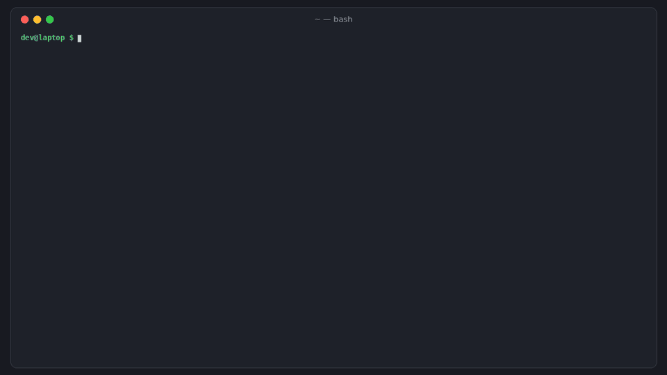

# reportsieve

[](https://github.com/hamarshehmhmd/reportsieve/actions/workflows/ci.yml)


[](LICENSE)

**Your security inbox got 5× bigger and most of it looks plausible.** reportsieve sits in front of a human:
it runs each report's PoC in a no-network sandbox, groups duplicates by crash signature and content, matches
reports against advisories you already published, scores how much evidence each one actually has, and hands you
a short "read these first" queue with a one-page brief per report.



> 🎬 2-minute narrated demo: [demo.mp4](https://github.com/hamarshehmhmd/reportsieve/releases/download/v0.1.0/demo.mp4)

## Why

AI didn't just bring slop. It brought *volume*, a lot of it valid-looking, and every report still needs a human:

- curl: report rate roughly doubled vs 2025, most reports now well written, ~15–16% confirmed, ~50 CVEs projected for 2026 ([Daniel Stenberg, "High-Quality Chaos"](https://daniel.haxx.se/blog/2026/04/22/high-quality-chaos/))
- OpenSSL: from ~9 security inquiries a month to 71, then 108 in Aug 2026; only 63 of ~500 reports in a year became disclosed vulns, each taking weeks to investigate ([Axios, Oct 2026](https://www.axios.com/2026/10/20/ai-bug-reports-overwhelm-openssl-maintainers))
- Node.js: 30+ vulnerability reports in one month vs 3 the year before ([OpenJS](https://openjsf.org/blog/ai-is-stress-testing-open-source))
- HN: [New problem: AI finds too many bugs](https://news.ycombinator.com/item?id=47700400), and the earlier [curl AI-slop thread](https://news.ycombinator.com/item?id=43907376) (454 pts)

The same bug now arrives three times in a week, written three different ways. Reputation gates and "did you use
AI?" checkboxes cut obvious spam, but nobody reproduces, dedupes or ranks the rest before a maintainer opens it.

## Install

```sh
curl -fsSL https://raw.githubusercontent.com/hamarshehmhmd/reportsieve/main/install.sh | sh
```

Uses `uv tool`, then `pipx`, then a private venv. Or directly:

```sh
uv tool install git+https://github.com/hamarshehmhmd/reportsieve     # or: pipx install git+https://...
```

Python 3.9+, no dependencies. For sandboxed PoC runs: [bubblewrap](https://github.com/containers/bubblewrap)
(`apt install bubblewrap`) on Linux, or Docker/Podman anywhere.

## Usage

```sh
reportsieve init                                   # writes reportsieve.json (scope, known advisories, build templates)

reportsieve triage inbox/                          # .md .txt .eml .json (HackerOne/GHSA/OSV-style exports)
reportsieve triage inbox/ --repo .                 # also check cited files/functions/lines exist in your code
reportsieve triage inbox/ --repo . --repro         # run every PoC in the sandbox, dedupe by real crash signature
reportsieve triage inbox/ --known gh:owner/repo    # match against your published GitHub advisories
reportsieve triage inbox/ --known osv:PyPI/requests   # ...or OSV (npm, PyPI, crates.io, Go, OSS-Fuzz, ...)
reportsieve triage gh:owner/repo                   # read reports from private vulnerability reporting (needs GITHUB_TOKEN with admin)
reportsieve triage inbox/ -f markdown -o triage.md # paste-able table + one brief per report (also: -f json)
reportsieve triage new/ --record                   # remember these so next week's re-reports dedupe against them

reportsieve repro report.md --repo . -v            # run one PoC, print the crash signature + output tail
reportsieve repro report.md --show                 # print the extracted files + script without running anything
reportsieve brief inbox/ --id r05-rce-callback     # one-page brief: evidence, what's missing, what to ask the reporter
```

Try it on the bundled demo inbox (a deliberately buggy toy C library and 8 reports):

```sh
git clone https://github.com/hamarshehmhmd/reportsieve && cd reportsieve/examples/tinyhdr
reportsieve triage reports/ --repo . --repro
```

```
reportsieve  8 reports: 2 confirmed · 1 needs-info · 2 duplicate · 1 known · 1 out-of-scope · 1 likely-noise
distinct issues: 5 · needs a human: 3 of 8 → read first: r01-heap-overflow-parse-header, r08-uaf-hdr-remove, r07-hdr-get-null

  VERDICT       SCORE  SEV      ID                              TITLE
  confirmed       100  high     r01-heap-overflow-parse-header  Heap buffer overflow in parse_header() with long header v…
                                ↳ reproduced in bwrap sandbox: asan:heap-buffer-overflow in parse_header
  confirmed        95  high     r08-uaf-hdr-remove              use-after-free in hdr_remove()
                                ↳ reproduced in bwrap sandbox: asan:heap-use-after-free in hdr_remove
  needs-info       10  low      r07-hdr-get-null                hdr_get() crashes on NULL name
                                ↳ ask for: a minimal PoC (input file or program) that triggers the issue; the exact version or commit you tested
  duplicate        75  high     r02-ai-writeup-same-overflow    [SECURITY] Critical Memory Corruption Vulnerability in ti…
                                ↳ duplicate of r01-heap-overflow-parse-header (1.00: same crash signature (asan:heap-buffer-overflow in parse_header))
  duplicate        20  medium   r03-short-dup-no-poc            overflow when header value > 64 bytes
                                ↳ duplicate of r01-heap-overflow-parse-header (0.76: both cite parse_header(); same class: out-of-bounds write)
  known            30  medium   r04-count-wrap-known            Integer overflow of hdr_list count in hdr_list_add()
                                ↳ matches known GHSA-demo-q7h2-x3kw (0.81: both cite count, hdr_list_add(); same class: integer overflow)
  out-of-scope     20  low      r06-bench-dos                   DoS: examples/bench.c allocates unbounded memory
                                ↳ only touches out-of-scope paths: examples/bench.c
  likely-noise      0  medium   r05-rce-callback                Remote Code Execution via tinyhdr_exec_callback() — CVSS …
                                ↳ claims CVSS 9.8 with no PoC or trace; claims code execution without evidence
```

Note r02: an AI-written, boilerplate-heavy report of a **real** bug. It isn't thrown away as slop; its PoC
reproduces the same crash as r01, so it's filed as a duplicate (and would have confirmed r01 if r01 had no PoC).

## What it does

| step | how |
|---|---|
| **Extract** | title/reporter/date (email headers, Markdown, JSON exports), CWE class (explicit or ~25 keyword rules), cited files, `file:line`, functions, header names/flags, versions/commits, CVSS claims, PoC code blocks (with "save as poc.c" filename hints, `$`-prompt stripping), pasted crash traces |
| **Reproduce** (`--repro`) | writes the PoC files into a throwaway copy of your repo and runs the report's own commands, or your per-language template (`{poc}`), with a timeout. Parses ASan/UBSan/MSan/TSan, gdb backtraces, signals, Python and JS tracebacks into a signature like `asan:heap-use-after-free in hdr_remove`. `--expect REGEX` for logic bugs and leaks. |
| **Dedupe** | same crash signature (top frames) = duplicate. Otherwise a weighted mix of shared code references (IDF-weighted, so `client` counts less than `parse_header`), TF-IDF wording similarity, and CWE overlap; different crash kinds or disjoint classes push apart. Near misses are listed as *related*. |
| **Known** | the same matching against your published GitHub advisories, OSV, or a folder of past advisories |
| **Cross-check** (`--repo`) | cited files that don't exist, line numbers past the end of the file, functions that aren't anywhere in the source (PoC-defined helpers excepted) |
| **Score** | evidence points (PoC, trace, version, steps, specific code, stated impact, sandbox repro) minus penalties (critical/CVSS 9+ with no evidence, speculative wording without proof, filler-heavy text, references that don't exist, PoC that ran clean) |
| **Route** | `confirmed` → `likely-valid` → `needs-info` (with the exact questions to send back) → `duplicate` → `known` → `out-of-scope` (your paths/CWEs/keywords) → `likely-noise` |

## Sandbox

PoCs are attacker-supplied code. reportsieve never runs them unless you pass `--repro` (or call `repro`).

- **bwrap** (default on Linux): new user/net/pid/ipc namespaces with **no network**, read-only `/usr` `/etc` `/lib`,
  empty tmpfs `/home` `/root` `/tmp`, cleared environment (your `GITHUB_TOKEN` etc. are not passed), a writable
  *copy* of the repo (`.git` excluded), process group killed on timeout.
- **docker / podman** (`--sandbox docker --image gcc:14`): `--network none`, `--cap-drop ALL`,
  `no-new-privileges`, pids/memory/CPU limits, your UID.
- **local**: no isolation; refused unless you add `--unsafe-local`. Don't use it on a machine with secrets.

Tests check that the bwrap sandbox can't reach the network, can't see a file in your real `$HOME`, doesn't receive
`GITHUB_TOKEN`, and can't modify your repo. A sandbox lowers risk, it doesn't remove it: run untrusted PoCs on a
machine you'd be OK losing.

## Policy file

`reportsieve.json` (in `--repo` or the current dir):

```json
{
  "project": "tinyhdr",
  "known": ["known/", "gh:owner/repo"],
  "out_of_scope": {"paths": ["examples/*", "tests/*"], "cwes": ["CWE-1333"], "keywords": ["self-xss"]},
  "duplicate_threshold": 0.6,
  "repro": {
    "timeout": 60,
    "setup": "make asan",
    "templates": {"c": "cc -g -fsanitize=address,undefined -Iinclude src/tinyhdr.c {poc} -o /tmp/poc && /tmp/poc"}
  }
}
```

## Honest limits

- It's heuristics, not a model, and it doesn't decide anything: it orders the queue and writes the brief.
  Scores are evidence counts, not severity. Suggested severity is a rough CWE-class guess.
- Content dedupe errs toward "same component + same class + similar wording". On undici's 61 published (distinct)
  advisories it groups 7 as duplicates, all close variants of each other (e.g. two TLS-validation bypasses through
  different connect paths). Treat `duplicate` as "read these together", and check `similarity`/`why` in the JSON.
- Reproduction works when the report gives a PoC that builds against your tree. Big C/C++ projects need a
  `setup` build step; network-service bugs need `--expect` and usually a docker image with the service.
- Filler-phrase detection is a weak signal on purpose (-10). Plenty of valid 2026 reports are AI-assisted.
- Pairs well with [checkrefs](https://github.com/hamarshehmhmd/checkrefs) for deep "does the cited code exist" checks.

## Development

```sh
pip install -e . pytest
pytest -q                       # bwrap/ASan tests skip if unavailable
REPORTSIEVE_LIVE=1 pytest -q    # + OSV and GitHub advisory lookups
REPORTSIEVE_DOCKER=1 pytest -q  # + docker runner
```

## License

GNU Affero General Public License v3.0 or later (`AGPL-3.0-or-later`); see [LICENSE](LICENSE).
Commercial licenses without the AGPL obligations are available from the author, Mohammad Hamarsheh
(open an issue or contact [@hamarshehmhmd](https://github.com/hamarshehmhmd)).
